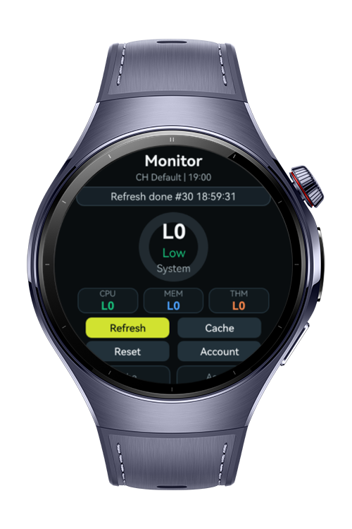
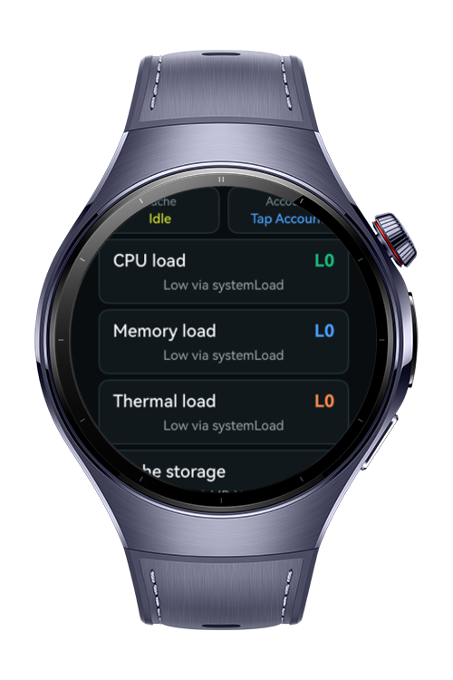
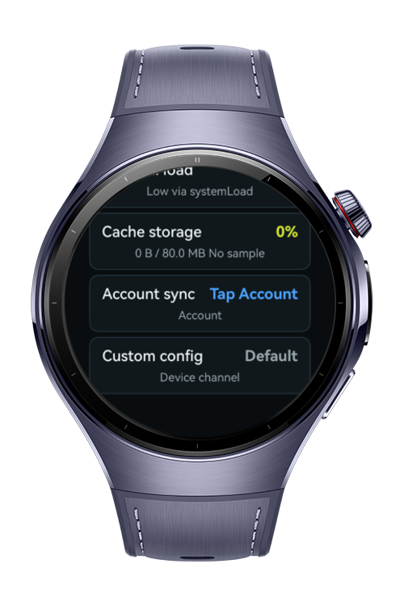

> **Note:** To access all shared projects, get information about environment setup, and view other guides, please visit [Explore-In-HMOS-Wearable Index](https://github.com/Explore-In-HMOS-Wearable/hmos-index).

# How to Build System Health Monitor

how-to-build-system-monitor is a wearable system health dashboard that uses `systemLoad` to query the current system load level, maps that level into CPU, memory, and thermal health bands, uses `cacheDownload` to manage background cache update operations and monitor download state, reads the active distributed account status with `distributedAccount`, and loads device-specific channel configuration with `customConfig`.

# Preview

<div>
  
  
  
</div>

# Use Cases

- Query real-time wearable system load levels with `systemLoad.getLevel`
- Listen for system load changes with `systemLoad.on('systemLoadChange')`
- Present CPU, memory, and thermal health bands from the current system load level
- Display a circular gauge for watch health during development
- Configure cache storage limits with `cacheDownload.setMemoryCacheSize` and `cacheDownload.setFileCacheSize`
- Start a forced background cache update with `cacheDownload.download` and `CacheStrategy.FORCE`
- Monitor cache update results with `cacheDownload.onDownloadSuccess` and `cacheDownload.onDownloadError`
- Read cache download history with `cacheDownload.getDownloadInfo`
- Clear memory and file cache with `cacheDownload.clearMemoryCache` and `cacheDownload.clearFileCache`
- Query active distributed account status with `distributedAccount.getOsAccountDistributedInfo`
- Request distributed account access with `ohos.permission.DISTRIBUTED_DATASYNC`
- Read device-specific custom configuration values with `customConfig.getChannelId`
- Log dashboard actions and API results for wearable debugging

# Technology

## Stack

- **Languages**: ArkTS, ArkUI
- **Frameworks**: HarmonyOS SDK 6.1.1(24)
- **Tools**: DevEco Studio 6.1.1
- **Libraries**:
    - `@kit.ArkUI`
    - `@kit.ArkTS`
    - `@kit.AbilityKit`
    - `@kit.BasicServicesKit`
    - `systemLoad`
    - `cacheDownload`
    - `distributedAccount`
    - `customConfig`

# Directory Structure

```
entry/
|-- src/
|   |-- main/
|   |   |-- module.json5
|   |   `-- ets/
|   |       |-- entryability/
|   |       |   `-- EntryAbility.ets
|   |       |-- entrybackupability/
|   |       |   `-- EntryBackupAbility.ets
|   |       `-- pages/
|   |           `-- Index.ets
```

# Constraints and Restrictions

## Supported Device

* Huawei Watch 5
* HarmonyOS wearable emulator

# License

**How to Build Rich Notification Center** is distributed under the terms of the MIT License. See the [LICENSE](LICENSE) for more information
